# Clock Lock Screen

[简体中文](README.md) ｜ **English**

> Your AI agent is still running, a download is halfway done, a script hasn't finished — you step away, but the PC must not sleep and nobody should touch your screen.

A small Windows lock-screen utility. It only covers the screen: it never touches the system power policy and never interrupts background processes. What covers the screen can be a nearly invisible transparent film, an adjustable black overlay, or a full-screen translucent flip clock.

<br>

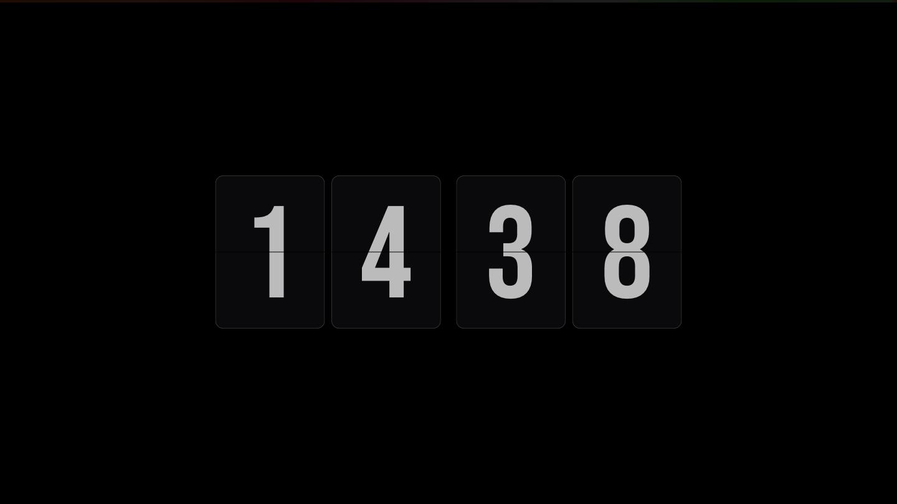

<p align="center"><sub>Default look: solid black background, Bebas Neue, clock opacity 80%</sub></p>

## Screenshots

<table>
<tr>
<td width="50%">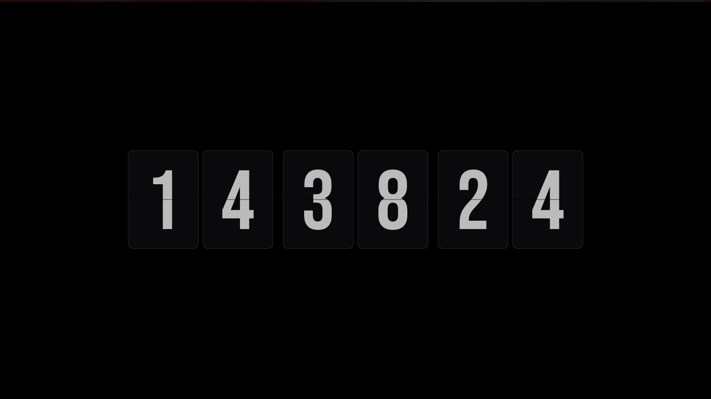<br><sub><b>Show seconds</b> — six cards, grouped hh : mm : ss</sub></td>
<td width="50%">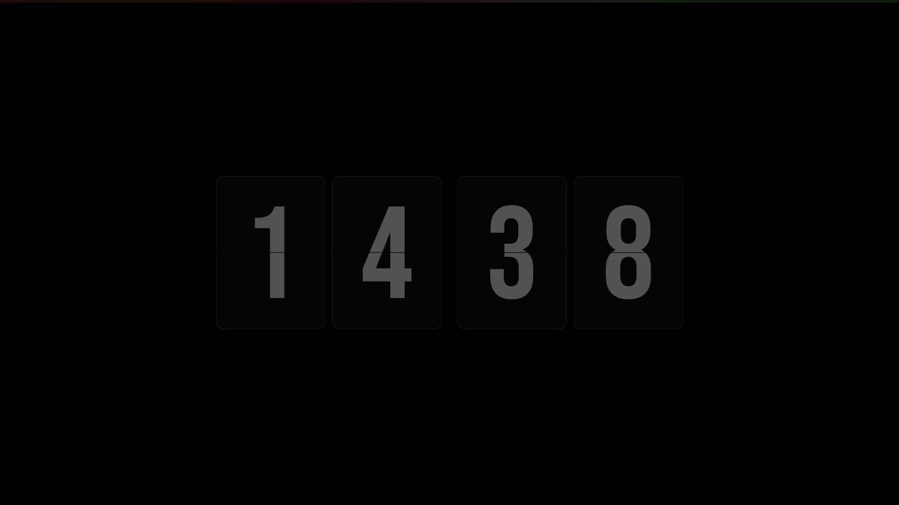<br><sub><b>Clock opacity 35%</b> — only a shadow remains, screen content unreadable</sub></td>
</tr>
<tr>
<td><br><sub><b>Mesh gradient · Royal</b> — layered radial blobs, no seams</sub></td>
<td>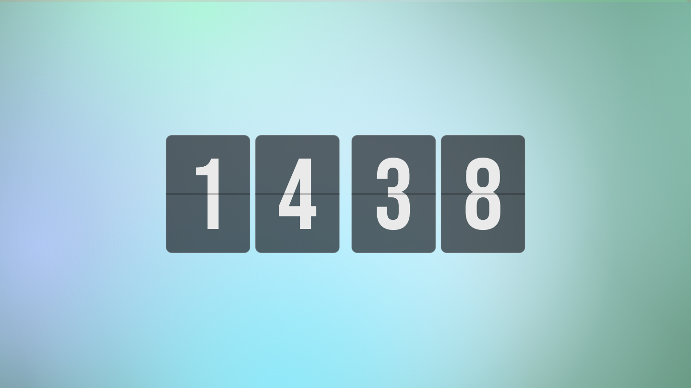<br><sub><b>Mesh gradient · Snow Mint</b></sub></td>
</tr>
<tr>
<td>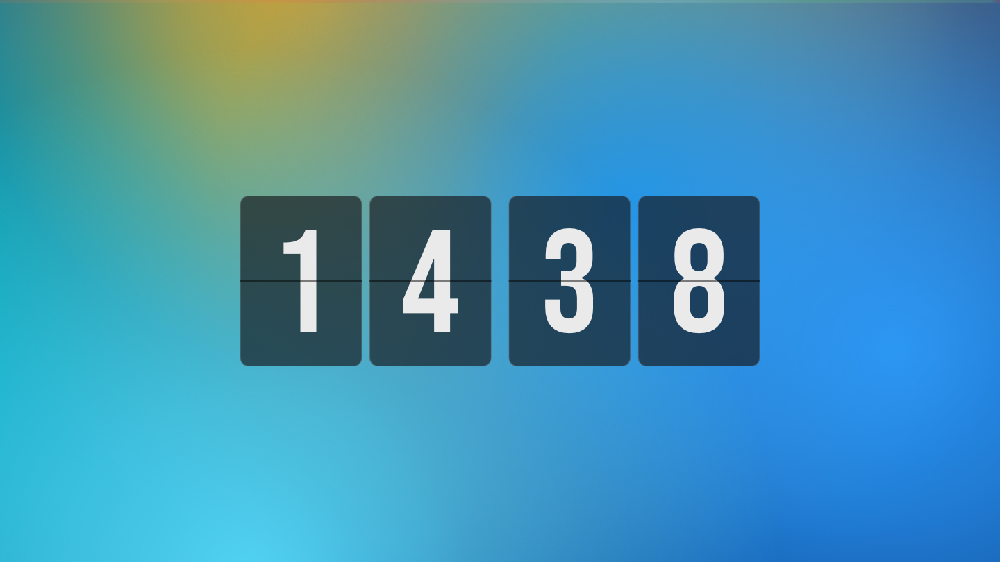<br><sub><b>Mesh gradient · Sunset</b> — 8 presets, palettes inspired by WLED</sub></td>
<td>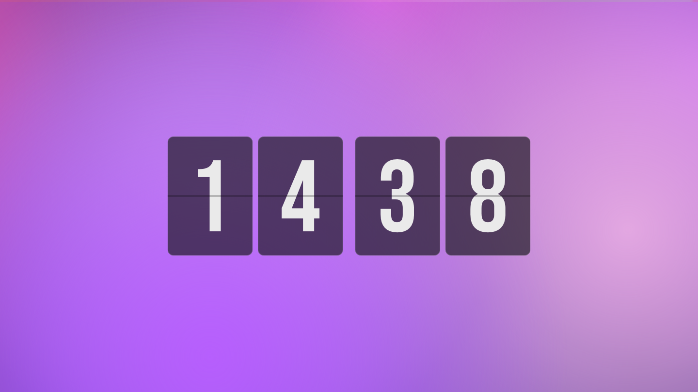<br><sub><b>Mesh gradient · Pink Haze</b></sub></td>
</tr>
<tr>
<td>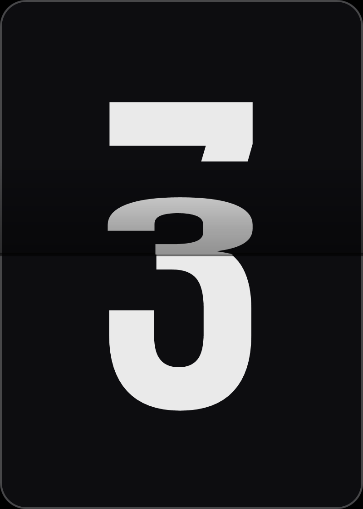<br><sub><b>Mid-flip · falling</b> — old digit folds down, new digit revealed above</sub></td>
<td>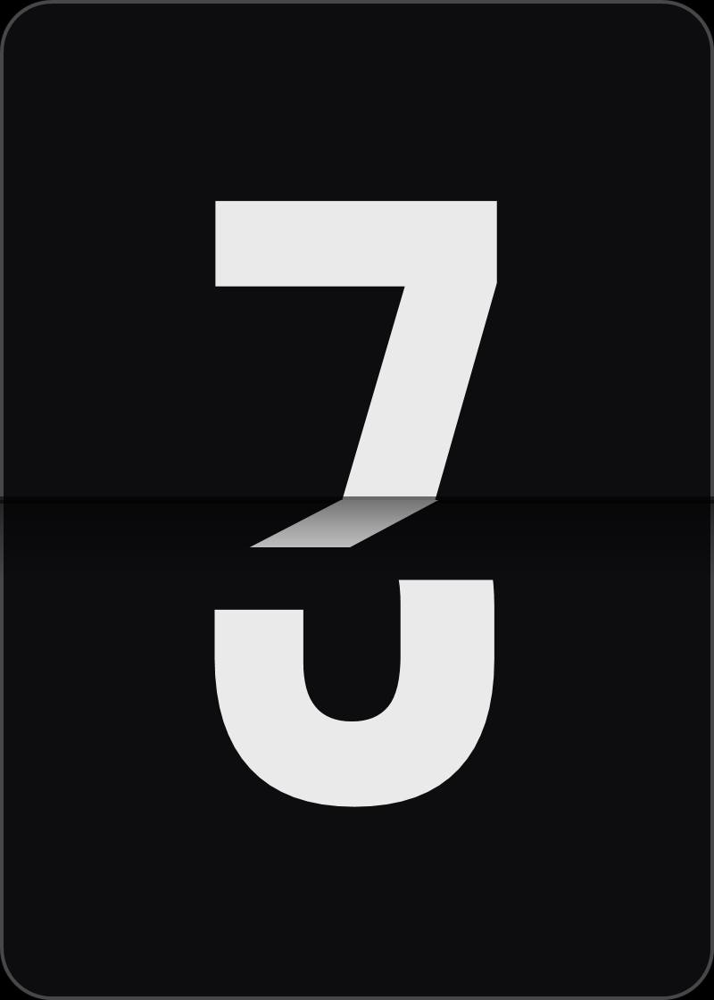<br><sub><b>Mid-flip · rising</b> — old and new digits never overlap</sub></td>
</tr>
<tr>
<td>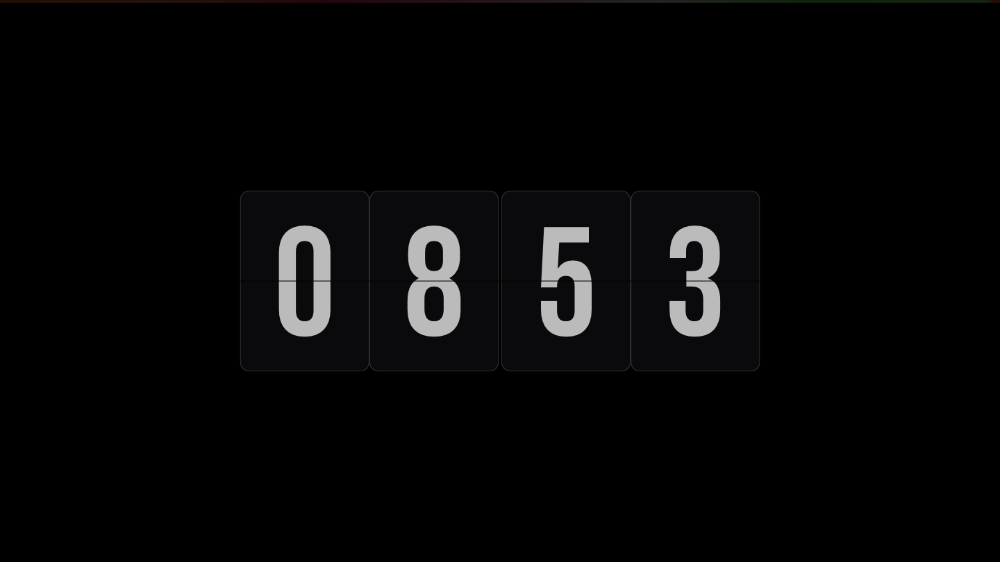<br><sub><b>Tight spacing</b> — digit gap 0 / group gap 4</sub></td>
<td>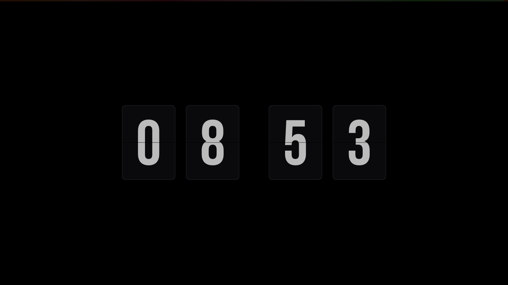<br><sub><b>Wide spacing</b> — digit gap 40 / group gap 110</sub></td>
</tr>
<tr>
<td>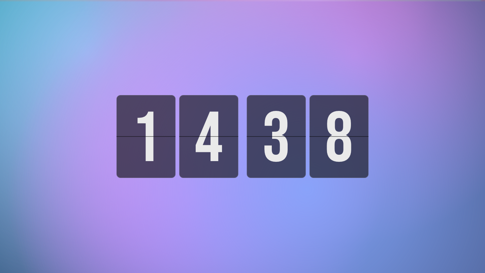<br><sub><b>Font · Bebas Neue</b> (default)</sub></td>
<td>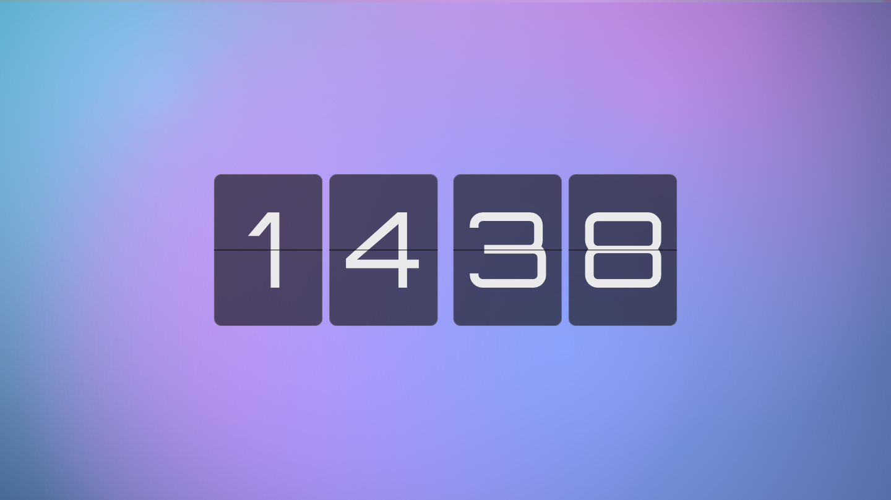<br><sub><b>Font · Orbitron</b> — size auto-fits the glyph box</sub></td>
</tr>
<tr>
<td>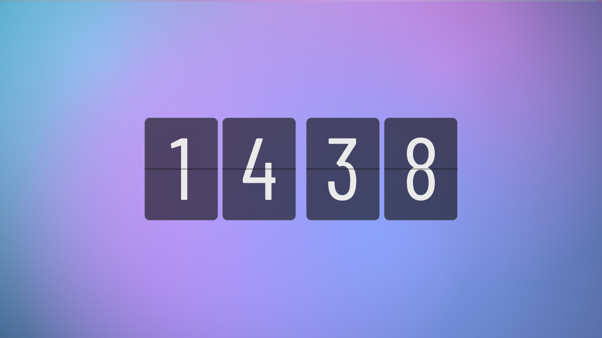<br><sub><b>Font · Barlow Condensed</b></sub></td>
<td><sub>Oswald / Archivo Narrow / Anton / Share Tech Mono are bundled too, and you can import your own <code>.ttf</code> / <code>.otf</code></sub></td>
</tr>
</table>

## What it solves

| Situation | Built-in Windows lock | Clock Lock Screen |
|---|---|---|
| Grabbing water / joining a meeting | Password every time, and a wait on return | One hotkey to lock, unlock instantly |
| Background jobs still running | Screen saver / sleep kicks in by default | Never touches the power policy, jobs keep running |
| Sensitive content on screen | Locks, but the look is fixed | Background and clock opacity are separate; at 20% only a shadow remains |
| Just don't want others clicking around | All or nothing | Transparent / overlay / clock — pick one |

## Features

- **Three lock appearances**
  - Fully transparent: nothing changes on screen, keyboard and mouse are locked
  - Black overlay: opacity adjustable 0–100%
  - Flip clock: solid or mesh-gradient background with flip digits, opacity and size adjustable
- **Flip clock**: four-layer clipped flip — top half falls, bottom half rises, no ghosting while squashing; optional seconds; extra gap between hh / mm / ss groups
- **Fonts**: 7 bundled SIL OFL fonts (Bebas Neue / Barlow Condensed / Oswald / Archivo Narrow / Anton / Orbitron / Share Tech Mono), plus import your own `.ttf` / `.otf`; font size auto-fits the glyph box
- **Everything adjustable**: background opacity, clock opacity, clock size, vertical position, digit gap, group gap, flip speed, animation frame rate (10–240 fps, default 60), card corner radius, card fill, card border, seam line, show seconds — all sliders or switches; dragging applies live, and every number can be typed in directly (two decimals)
- **Palettes**: solid black by default (lightest); 8 mesh-gradient backgrounds and 12 light-bar palettes inspired by [WLED](https://github.com/wled/WLED), with optional drift. Gradients cost noticeably more CPU / memory — the settings page says so up front
- **Settings UI**: Windows 11 acrylic with Windows 11 style switches, changes apply instantly
- **Preview mode**: no locking — renders the effect on top of the desktop with click-through, so you can tweak while watching
- **Hotkeys**: customisable lock / unlock hotkeys, run at startup, auto-lock, and post-unlock actions

## Requirements

- Windows 10 / 11 (Windows 7 / 8 untested)
- [.NET 8 Desktop Runtime](https://aka.ms/dotnet/8.0/windowsdesktop-runtime-win-x64.exe)
- [WebView2 Runtime](https://developer.microsoft.com/microsoft-edge/webview2/) (usually preinstalled on Windows 11)

Memory is reclaimed automatically after unlocking. While locked, the footprint is mostly the cost of a full-screen layered WPF window (about 100 MB).

Administrator rights are required on first run (locking and global hotkeys). Settings live in `%LOCALAPPDATA%\ClockLockScreen\config.json`; delete that file to reset a forgotten password.

## Build

```bash
git clone <this-repo>
cd src/ComputerLock
dotnet publish -c Release -r win-x64 --self-contained false -o ../../dist
```

Ship `ClockLockScreen.exe` together with `wwwroot/`, `fonts/` and `WebView2Loader.dll`.

## Fonts

The 7 fonts under `fonts/` are licensed under the [SIL Open Font License 1.1](fonts/FONT-LICENSE.txt) and may be redistributed with the program (commercial use included); the fonts themselves are not sold separately.

## Credits

Built on top of [JiuLing-zhang/ComputerLock](https://github.com/JiuLing-zhang/ComputerLock), with the flip clock and settings UI rewritten. The original author's copyright notice is kept as required by the MIT license.

## License

[MIT License](LICENSE) © 2022 九零, © 2026 ruilin365
