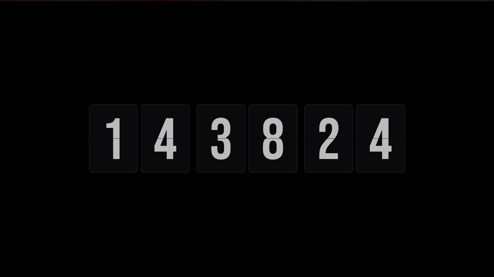
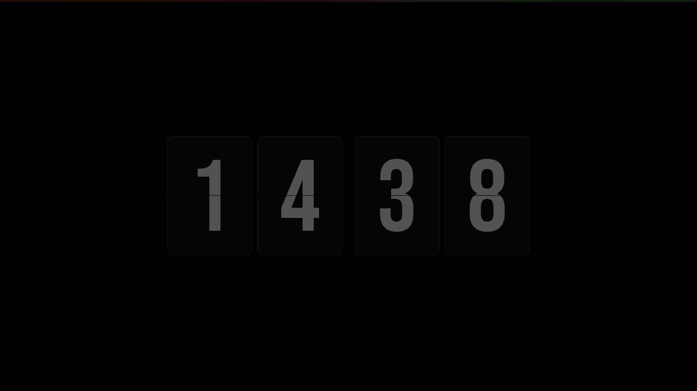
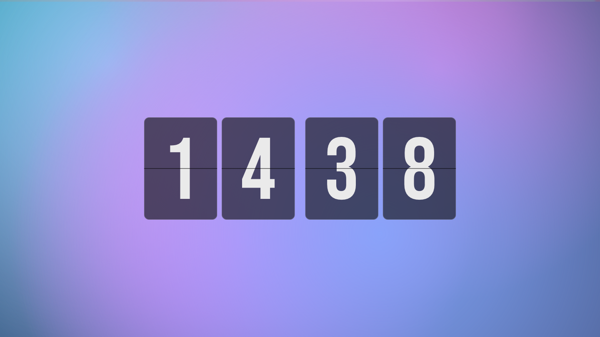
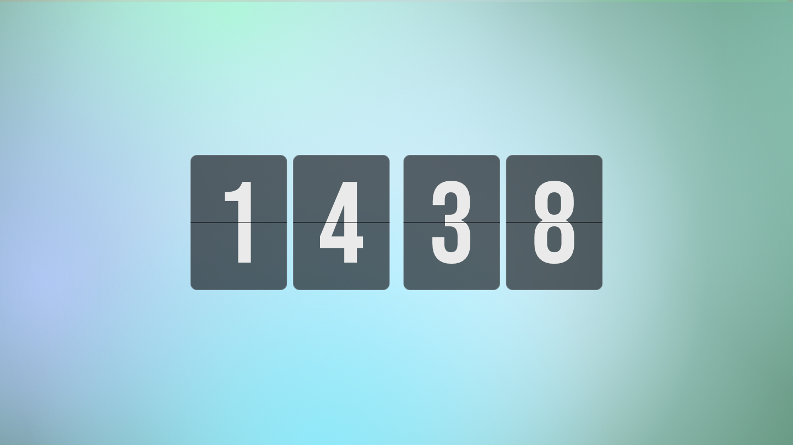
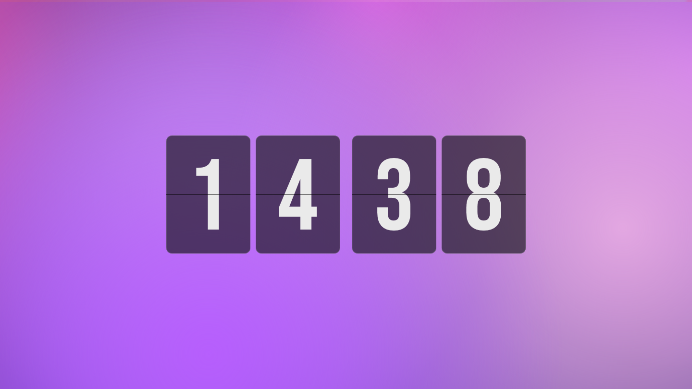
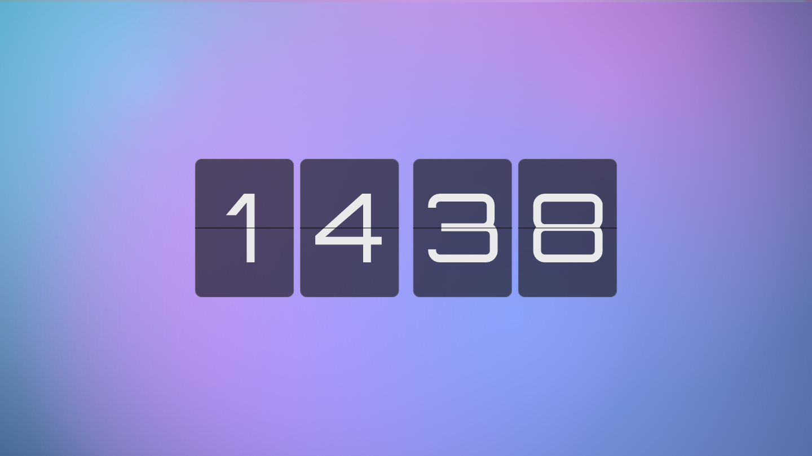
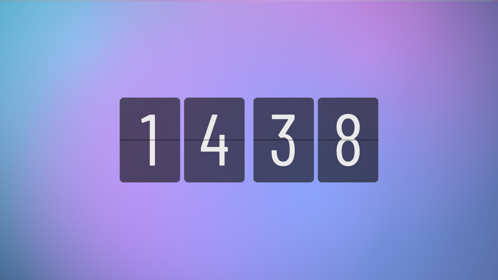

# 时钟锁屏 · Clock Lock Screen

**简体中文** ｜ [English](README.en.md)

> 离开电脑一会儿，AI Agent 还在跑、下载还没完、脚本还没结束 —— 既不能让电脑休眠，又不想让别人动你的屏幕。

一个 Windows 锁屏小工具。它只把屏幕盖住，不接管系统休眠、不打断后台进程。画面由三层叠成——**屏幕模糊（毛玻璃）**、**全屏遮罩**（任意纯色或渐变）、**翻页时钟**；三层各自独立开关，可以随便组合，全关就是完全透明。

<br>


<p align="center"><sub>默认外观：纯黑单色背景，Bebas Neue，时钟不透明度 80%</sub></p>

## 效果

<table>
<tr>
<td width="50%"><br><sub><b>显示秒</b>　六张牌，时分秒分组</sub></td>
<td width="50%"><br><sub><b>时钟不透明度 35%</b>　只剩一层影子，看不清屏幕内容</sub></td>
</tr>
<tr>
<td><br><sub><b>网格渐变 · Royal</b>　多层径向色块，无接缝</sub></td>
<td><br><sub><b>网格渐变 · Snow Mint</b></sub></td>
</tr>
<tr>
<td><br><sub><b>网格渐变 · Sunset</b>　8 套预设，参考 WLED 配色</sub></td>
<td><br><sub><b>网格渐变 · Pink Haze</b></sub></td>
</tr>
<tr>
<td><br><sub><b>翻页中 · 上半翻落</b>　旧数字压扁翻下，新数字从上方露出</sub></td>
<td><br><sub><b>翻页中 · 下半翻起</b>　新旧数字不叠影</sub></td>
</tr>
<tr>
<td><br><sub><b>间距紧凑</b>　数字间距 0 / 组间距 4</sub></td>
<td><br><sub><b>间距宽松</b>　数字间距 40 / 组间距 110</sub></td>
</tr>
<tr>
<td><br><sub><b>字体 · Bebas Neue</b>（默认）</sub></td>
<td><br><sub><b>字体 · Orbitron</b>　字号按字形自动适配</sub></td>
</tr>
<tr>
<td><br><sub><b>字体 · Barlow Condensed</b></sub></td>
<td><sub>还内置 Oswald / Archivo Narrow / Anton / Share Tech Mono，也可以导入自己的 <code>.ttf</code> / <code>.otf</code></sub></td>
</tr>
</table>

## 它解决什么

| 场景 | 系统自带锁屏 | 时钟锁屏 |
|---|---|---|
| 只是去接杯水 / 开个会 | 每次都输密码，回来还要等 | 快捷键一秒锁，回来直接解锁 |
| 后台还有程序在跑 | 默认会进屏保/休眠 | 不干预系统电源策略，照常运行 |
| 屏幕上是不想被看到的敏感内容 | 有锁屏，但样式固定 | 遮罩不透明度调到 20%，只剩一层影子；还能垫一层模糊，看得出轮廓看不出内容 |
| 后台日志在滚，想知道还活着 | 锁屏后什么都看不到 | 开实时模糊，背后滚动的文字隐约可见 |

## 功能

- **三层画面，自由组合**（从下到上：模糊 → 遮罩 → 时钟）
  - 屏幕模糊（毛玻璃）：定格 / 实时两种方式，强度 0–100% 可调。定格在锁屏瞬间截一张，隐私最好、最省 CPU；实时按 1–10fps 重新取景，背后有东西在动也看得出来
  - 全屏遮罩：铺满整屏的一层颜色，任意纯色或网格渐变，不透明度 0–100%
  - 翻页时钟：只剩数字与牌面，不带背景
- **翻页时钟**：四层裁剪式翻页结构，上半翻落、下半翻起，压扁过程不叠影；可显示秒；时分秒分组间距
- **字体**：内置 7 款 SIL OFL 开源字体（Bebas Neue / Barlow Condensed / Oswald / Archivo Narrow / Anton / Orbitron / Share Tech Mono），支持导入自己的 `.ttf` / `.otf`，字号按字形自动适配
- **可调项**：模糊强度、遮罩不透明度、时钟不透明度、时钟大小、垂直位置、数字间距、时分秒间距、翻页速度、动画帧率（10–240fps，默认 90）、牌面圆角、牌面浓度、边框、中缝线、显示秒，全部是滑块或开关；拖动实时生效，数值可直接点开手输（支持两位小数）
- **配色**：遮罩默认黑色 35%（最省资源）；另有 8 套网格渐变配色、12 套光条配色，参考 [WLED](https://github.com/wled/WLED) 的预设方案，支持动态流动。渐变会明显更吃 CPU / 内存，设置页里已标注
- **恢复默认外观**：一键把模糊、遮罩、时钟、状态提示恢复出厂值，密码、快捷键、自动锁定不受影响
- **设置界面**：Win11 毛玻璃 + Win11 风格开关，改一项即时生效
- **预览模式**：不锁屏，把效果叠在桌面最上层（鼠标点击穿透），边调边看
- **快捷键**：锁定 / 解锁快捷键可自定义，支持开机自启、自动锁定、解锁后自动执行动作

## 运行环境

- Windows 10 / 11（Win7、Win8 未测试）
- [.NET 8 Desktop Runtime](https://aka.ms/dotnet/8.0/windowsdesktop-runtime-win-x64.exe)
- [WebView2 Runtime](https://developer.microsoft.com/microsoft-edge/webview2/)（Win11 通常已内置）

解锁后会自动回收内存，锁屏时的占用主要是 WPF 全屏分层窗口本身的成本（约 100MB）。

首次运行需要管理员权限（锁屏与全局快捷键需要），配置文件位于 `%LOCALAPPDATA%\ClockLockScreen\config.json`，忘记密码时删除该文件即可重置。

## 构建

```bash
git clone <this-repo>
cd src/ComputerLock
dotnet publish -c Release -r win-x64 --self-contained false -o ../../dist
```

产物 `ClockLockScreen.exe` 需要连同 `wwwroot/`、`fonts/`、`WebView2Loader.dll` 一起分发。

## 字体

`fonts/` 下随附的 7 款字体均为 [SIL Open Font License 1.1](fonts/FONT-LICENSE.txt) 授权，可随程序自由分发（含商业用途）；不单独售卖字体本身。

## 致谢

本项目基于 [JiuLing-zhang/ComputerLock](https://github.com/JiuLing-zhang/ComputerLock) 二次开发，在其锁屏框架上重做了翻页时钟与设置界面。原作者版权声明依 MIT 协议保留。

## 许可证

[MIT License](LICENSE) © 2022 九零、© 2026 ruilin365
